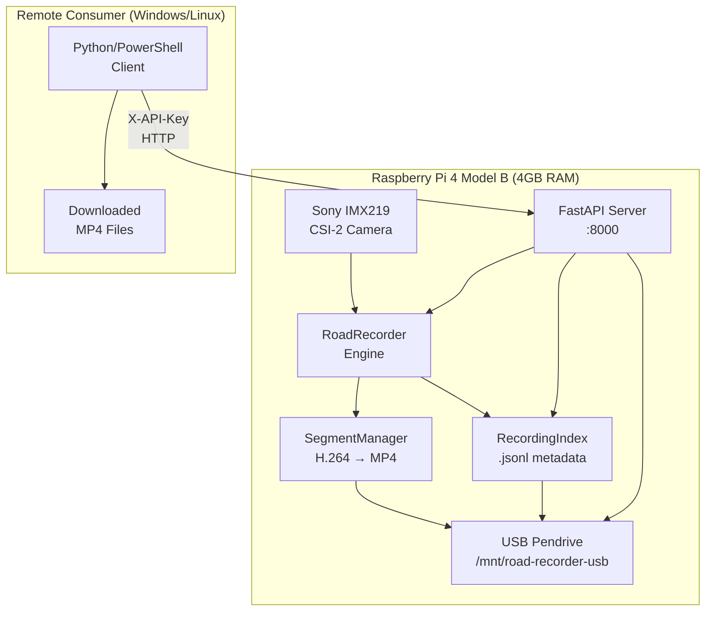

# Road Recorder: Raspberry Pi 4 Video Data API & Dashcam

A standalone, production-minded Python application for continuous road-facing video recording on a Raspberry Pi 4 Model B.  
Includes an **authenticated FastAPI Video Data API** for remote computer vision teams to request, poll, and download MP4 recordings over the network.

> **Government Road Inspection Industry Project — PMC Pune Demonstration**

---

## Architecture Overview



---

## 1. Project Directory Structure

```text
Road-Recorder/
├── hardware/                                # Standalone hardware diagnostics (zero external dependencies)
│   ├── camera/
│   │   ├── camera_detect.py                 # Detects physical CSI camera (IMX219, IMX708, etc.)
│   │   ├── camera_test.py                   # Performs 5-second test capture (checks sensor & encoder)
│   │   └── camera_preview.py                # Displays live preview window (if desktop display is connected)
│   ├── storage/
│   │   ├── storage_check.py                 # Inspects block devices, mount points, UUID, and permissions
│   │   └── usb_setup.py                     # Guided USB pendrive setup and /etc/fstab configuration
│   ├── diagnostics/
│   │   └── system_info.py                   # Reports RPi 4 model, OS version, RAM, and camera tools
│   ├── __init__.py
│   └── README.md
├── road_recorder/                           # Core continuous recording engine
│   ├── __init__.py
│   ├── config.py                            # Loads and validates config.yaml with full fallback support
│   ├── camera.py                            # Supervises rpicam-vid / libcamera-vid capture processes
│   ├── recorder.py                          # Central recording state machine and segment coordinator
│   ├── segment_manager.py                   # Manages segment rotation, filenames, and MP4 stream remuxing
│   ├── storage_manager.py                   # Monitors USB space and strictly prevents microSD fallback
│   ├── recording_index.py                   # Append-only JSON Lines index (metadata/recording_index.jsonl)
│   ├── logging_setup.py                     # Immediate-flush file and console logging
│   ├── usb_gate.py                          # Pre-flight USB gate (systemd ExecStartPre & lifespan check)
│   └── api/                                 # FastAPI Video Data API
│       ├── __init__.py
│       ├── auth.py                          # Cryptographic constant-time API key verification
│       ├── keygen.py                        # CLI tool for key generation and rotation
│       ├── schemas.py                       # Pydantic request/response models
│       ├── dependencies.py                  # FastAPI dependency injection (recorder, config, auth)
│       └── routes/
│           ├── __init__.py
│           ├── device.py                    # GET /api/v1/device/status, GET /api/v1/health
│           ├── recordings.py               # Start/stop/list/download/metadata endpoints
│           └── stream.py                    # Live stream session lifecycle & CSI concurrency analysis
├── tests/                                   # Unit and integration test suite
│   ├── __init__.py
│   ├── test_config.py                       # Tests configuration parsing and threshold validation
│   ├── test_storage_manager.py              # Tests USB verification, SD card refusal, and thresholds
│   ├── test_segment_manager.py              # Tests naming conventions, MP4 finalization, and crash recovery
│   ├── test_recording_index.py              # Tests append-only integrity and corrupted line resilience
│   ├── test_recorder_lifecycle.py           # Tests orchestrator start/stop and single-instance locks
│   └── test_api.py                          # FastAPI integration tests (auth, lifecycle, streaming, range)
├── systemd/
│   └── road-recorder-api.service            # Systemd unit file for auto-start with USB gating
├── examples/
│   └── client_consumer.py                   # Remote consumer client (Record → Poll → Download → Verify)
├── config.yaml                              # Production configuration file
├── api_server.py                            # FastAPI server entrypoint
├── main.py                                  # Interactive beginner-friendly terminal interface
├── inspect_environment.py                   # One-shot unified environment & hardware inspector
├── run_tests.py                             # Zero-dependency test runner
├── requirements.txt                         # Python requirements
├── .env.example                             # Environment variable template
├── .gitignore
└── README.md
```

### Dedicated USB Storage Layout (`/mnt/road-recorder-usb`)

```text
/mnt/road-recorder-usb/
├── recordings/
│   └── YYYY-MM-DD/
│       ├── RR_YYYYMMDD_HHMMSS_001.mp4
│       └── RR_YYYYMMDD_HHMMSS_002.mp4
├── metadata/
│   └── recording_index.jsonl
├── logs/
│   └── recording.log
├── diagnostics/
├── .road-recorder-volume
└── .road-recorder-api.key
```

---

## 2. Operating Environment: Windows vs. Raspberry Pi

> [!IMPORTANT]
> **Windows vs Raspberry Pi Terminal:**
> - If you are editing files on a Windows laptop, run git and editing commands on Windows.
> - **All hardware commands, camera tools, API server, and recording executions must be run directly inside a terminal on the Raspberry Pi.**

---

## 3. Quick Start on Raspberry Pi OS

### Step 1: Open Terminal on Raspberry Pi
Open the Raspberry Pi OS terminal (via desktop menu or shortcut `Ctrl+Alt+T`).

### Step 2: Navigate to Project Folder
```bash
cd /mnt/road-recorder-usb/road-recorder/Road-Recorder
```

### Step 3: Install System Prerequisites
```bash
sudo apt update
sudo apt install -y rpicam-apps ffmpeg python3-yaml python3-pip python3-venv
```

### Step 4: Install Python Dependencies
```bash
pip install -r requirements.txt
```

### Step 5: Run Environment & Hardware Check
```bash
python3 inspect_environment.py
```

---

## 4. Configuring the USB Pendrive Storage

Road Recorder strictly requires recording to an external USB pendrive (`/mnt/road-recorder-usb`) to protect your 32 GB boot microSD card from wear and space exhaustion.

### Option A: Guided Setup Assistant (Recommended)
```bash
python3 hardware/storage/usb_setup.py
```

### Option B: Manual USB Mount Configuration
1. **Identify the USB drive partition and UUID:**
   ```bash
   lsblk -o NAME,SIZE,FSTYPE,MOUNTPOINT,UUID,MODEL,TRAN
   ```

2. **Create mount directory:**
   ```bash
   sudo mkdir -p /mnt/road-recorder-usb
   ```

3. **Back up and edit `/etc/fstab`:**
   ```bash
   sudo cp /etc/fstab /etc/fstab.bak.$(date +%Y%m%d_%H%M%S)
   sudo nano /etc/fstab
   ```
   Append (replace UUID with your actual value):
   ```text
   UUID=70AA-2D80  /mnt/road-recorder-usb  exfat  defaults,nofail,uid=1000,gid=1000,umask=022  0  0
   ```

4. **Mount and set ownership:**
   ```bash
   sudo mount -a
   sudo chown -R $USER:$USER /mnt/road-recorder-usb
   ```

5. **Initialize folders and volume marker:**
   ```bash
   python3 hardware/storage/usb_setup.py --init-dirs /mnt/road-recorder-usb
   ```

---

## 5. Running the Application

### Terminal Menu (Interactive Mode)
```bash
python3 main.py
```

### Main Menu Controls
- **1. Start Recording:** Begins continuous video capture in 5-minute segments.
- **2. Stop Recording:** Safely halts capture, finalizes the active segment, and updates the index.
- **3. View Status & Refresh:** Displays live elapsed time, active file size, and storage metrics.
- **4. List Recordings on USB:** Displays recent segments with duration and file sizes.
- **5. View USB Storage Diagnostics:** Checks mount status, write health, and block devices.
- **6. Run USB Setup Assistant:** Reruns the interactive `/etc/fstab` configuration helper.
- **7. Exit Application:** Safely exits the program.

### Safe Graceful Shutdown
Press `Ctrl+C` at any time. The application will:
1. Stop the camera capture process.
2. Finalize and verify the in-progress video segment.
3. Append segment metadata to `recording_index.jsonl`.
4. Release camera and file locks.
5. Exit cleanly without orphaned background processes.

---

## 6. Video Data API Server

### Starting the API Server
```bash
python3 api_server.py
```

The server starts on `http://0.0.0.0:8000` with interactive Swagger docs at `/docs`.

### API Key Setup

Generate a cryptographically random API key:
```bash
python3 -m road_recorder.api.keygen --generate
```

The key is stored securely on the USB drive at `/mnt/road-recorder-usb/.road-recorder-api.key`.  
Alternatively, set it via environment variable:
```bash
export ROAD_RECORDER_API_KEY="your-secret-key-here"
```

### API Key Rotation
```bash
# Generate a new key (invalidates the old one immediately)
python3 -m road_recorder.api.keygen --rotate

# View the current active key
python3 -m road_recorder.api.keygen --show
```

### API Endpoints Reference

| Method | Endpoint | Auth | Description |
|--------|----------|------|-------------|
| `GET` | `/api/v1/health` | ✗ | Health check (storage readiness) |
| `GET` | `/api/v1/device/status` | ✓ | Full device telemetry (camera, storage, recording) |
| `POST` | `/api/v1/recordings/start` | ✓ | Start recording session (optional `duration_seconds`) |
| `POST` | `/api/v1/recordings/stop` | ✓ | Stop active recording session |
| `GET` | `/api/v1/recordings/{session_id}` | ✓ | Get session status |
| `GET` | `/api/v1/recordings` | ✓ | Paginated recording list (`page`, `per_page`, `date`) |
| `GET` | `/api/v1/recordings/{id}/video` | ✓ | Download MP4 (supports HTTP Range 206) |
| `GET` | `/api/v1/recordings/{id}/metadata` | ✓ | Get recording metadata |
| `GET` | `/api/v1/stream/status` | ✓ | Live stream status & hardware analysis |
| `POST` | `/api/v1/stream/start` | ✓ | Start live stream session |
| `POST` | `/api/v1/stream/stop` | ✓ | Stop live stream session |

### Swagger UI

Open `http://<raspberry-pi-ip>:8000/docs` in a browser for interactive API testing with the "Authorize" button.

---

## 7. Remote Consumer Workflow

### Workflow 1: Record & Download (Recommended Production Pathway)

```
Consumer                        Raspberry Pi API
   │                                   │
   ├── GET /health ──────────────────► │  Check device readiness
   │◄─────────── {"healthy"} ──────────┤
   │                                   │
   ├── POST /recordings/start ───────► │  Request 60s recording
   │   {"duration_seconds": 60}        │
   │◄─── {"session_id": "session_..."} ┤
   │                                   │
   ├── GET /recordings/{session} ────► │  Poll until "completed"
   │◄────── {"status": "recording"} ───┤
   │  ...                              │
   │◄────── {"status": "completed"} ───┤
   │                                   │
   ├── GET /recordings ──────────────► │  List available MP4s
   │◄────── {"items": [...]} ──────────┤
   │                                   │
   ├── GET /recordings/{id}/video ───► │  Download with Range support
   │◄───────── chunked MP4 stream ─────┤
   │                                   │
   └── Verify MP4                      │
```

### Python Consumer Client
```bash
# Full workflow: health → record 30s → poll → download → verify
python3 examples/client_consumer.py --host 192.168.1.100 --api-key YOUR_KEY --duration 30

# Health check only
python3 examples/client_consumer.py --host 192.168.1.100 --api-key YOUR_KEY --health-only

# List existing recordings
python3 examples/client_consumer.py --host 192.168.1.100 --api-key YOUR_KEY --list-only
```

### Windows PowerShell Quick Test
```powershell
$headers = @{ "X-API-Key" = "YOUR_API_KEY" }
$base = "http://192.168.1.100:8000"

# Health check
Invoke-RestMethod "$base/api/v1/health"

# Device status
Invoke-RestMethod "$base/api/v1/device/status" -Headers $headers

# Start 30-second recording
$body = '{"duration_seconds": 30}'
$session = Invoke-RestMethod "$base/api/v1/recordings/start" -Method Post -Headers $headers -Body $body -ContentType "application/json"
$session.session_id

# Poll session
Start-Sleep -Seconds 35
Invoke-RestMethod "$base/api/v1/recordings/$($session.session_id)" -Headers $headers

# List recordings
$recordings = Invoke-RestMethod "$base/api/v1/recordings" -Headers $headers
$recordings.items

# Download MP4
$id = $recordings.items[0].recording_id
Invoke-WebRequest "$base/api/v1/recordings/$id/video" -Headers $headers -OutFile "$id.mp4"
```

### Linux cURL Quick Test
```bash
API_KEY="YOUR_API_KEY"
BASE="http://192.168.1.100:8000"

# Health check
curl -s "$BASE/api/v1/health" | python3 -m json.tool

# Start recording
curl -s -X POST "$BASE/api/v1/recordings/start" \
  -H "X-API-Key: $API_KEY" -H "Content-Type: application/json" \
  -d '{"duration_seconds": 30}'

# Download with Range support
curl -H "X-API-Key: $API_KEY" -o recording.mp4 \
  "$BASE/api/v1/recordings/RR_20261013_210000_001/video"
```

---

## 8. Systemd Auto-Start Service

Install the systemd service for headless auto-start on boot:

```bash
# Copy service file
sudo cp systemd/road-recorder-api.service /etc/systemd/system/

# Reload systemd daemon
sudo systemctl daemon-reload

# Enable auto-start on boot
sudo systemctl enable road-recorder-api

# Start the service now
sudo systemctl start road-recorder-api

# Check status
sudo systemctl status road-recorder-api

# View logs
journalctl -u road-recorder-api -f
```

The service is gated by:
- `ConditionPathIsMountPoint=/mnt/road-recorder-usb` — won't start if USB is unmounted
- `ConditionPathExists=/mnt/road-recorder-usb/.road-recorder-volume` — validates volume marker
- `ExecStartPre` — runs `usb_gate.py` to verify UUID `70AA-2D80` and read/write capability

---

## 9. Locating and Playing Saved Videos

- **Command Line:**
  ```bash
  ls -lh /mnt/road-recorder-usb/recordings/$(date +%Y-%m-%d)/
  ```
- **Raspberry Pi File Manager:**
  ```bash
  pcmanfm /mnt/road-recorder-usb/recordings
  ```
- **Play Video (VLC):**
  ```bash
  vlc /mnt/road-recorder-usb/recordings/$(date +%Y-%m-%d)/*.mp4
  ```

---

## 10. Running Tests

### Full Test Suite (Core + API)
```bash
python3 run_tests.py
```

### With pytest
```bash
pytest -v tests/
```

### Windows (Python 3.13)
```bash
py -3.13 run_tests.py
```

---

## 11. Camera Concurrency Architecture

> [!WARNING]
> **Hardware Limitation:** The Sony IMX219 CSI-2 camera on Raspberry Pi 4 is accessed via the Linux `unicam` driver, which grants **exclusive single-process access** to the camera buffer. When `rpicam-vid` records to an MP4 file, a second camera capture process **cannot** simultaneously open the sensor.

| Workflow | Status | Description |
|----------|--------|-------------|
| **Workflow 1: Record & Download** | ✅ Production Ready | Consumer requests bounded recording → polls → downloads finalized MP4. 100% video integrity. |
| **Workflow 2: Live Streaming** | ⚠️ Experimental | Requires mutual exclusion with recording. Future: `rpicam-vid -o - | tee` multiplexer or Picamera2 multi-stream. |

---

## 12. Troubleshooting

| Symptom | Cause | Solution |
|---|---|---|
| `"USB recording drive not available"` | USB pendrive is unplugged or `/mnt/road-recorder-usb` is not mounted. | Plug in USB, run `sudo mount -a`, verify with `python3 hardware/storage/storage_check.py`. |
| `"No physical camera detected"` | Loose CSI ribbon cable or camera disabled. | Check ribbon cable (blue tape faces Ethernet/USB ports on RPi 4). Run `rpicam-hello --list-cameras`. |
| `"Another instance of Road Recorder is currently active"` | Stale lock file from a crashed prior instance. | `rm ~/.road_recorder.lock` |
| `"Critical storage threshold reached"` | Free space on USB pendrive below 1024 MB. | Offload older recordings from `/mnt/road-recorder-usb/recordings/`. |
| `401 Unauthorized` (API) | Missing or invalid `X-API-Key` header. | Run `python3 -m road_recorder.api.keygen --show` to verify your key. |
| `503 Service Unavailable` (API) | USB drive not mounted or UUID mismatch. | Mount USB and check `journalctl -u road-recorder-api`. |
| `409 Conflict` (API) | Recording already in progress. | Stop the active session first: `POST /api/v1/recordings/stop`. |
| Systemd service won't start | USB drive not mounted at boot time. | Ensure `/etc/fstab` entry has `nofail`. Check `systemctl status road-recorder-api`. |

---

## License

This project is developed for the PMC Pune road inspection demonstration.
