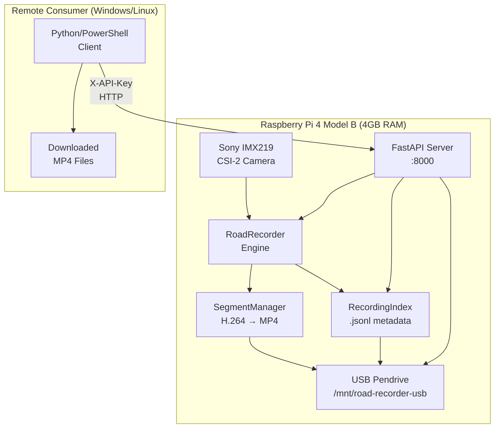

# Road Recorder: Raspberry Pi 4 Video Data API & Dashcam

A standalone, production-minded Python application for continuous road-facing video recording on a Raspberry Pi 4 Model B.  
Includes an **authenticated FastAPI Video Data API** for remote computer vision teams to request, poll, and download MP4 recordings over the network.

> **Government Road Inspection Industry Project — PMC Pune Demonstration**

---

## Architecture Overview



---

## 1. Project Directory Structure

```text
Road-Recorder/
├── hardware/                                # Standalone hardware diagnostics (zero external dependencies)
│   ├── camera/
│   │   ├── camera_detect.py                 # Detects physical CSI camera (IMX219, IMX708, etc.)
│   │   ├── camera_test.py                   # Performs 5-second test capture (checks sensor & encoder)
│   │   └── camera_preview.py                # Displays live preview window (if desktop display is connected)
│   ├── storage/
│   │   ├── storage_check.py                 # Inspects block devices, mount points, UUID, and permissions
│   │   └── usb_setup.py                     # Guided USB pendrive setup and /etc/fstab configuration
│   ├── diagnostics/
│   │   └── system_info.py                   # Reports RPi 4 model, OS version, RAM, and camera tools
│   ├── __init__.py
│   └── README.md
├── road_recorder/                           # Core continuous recording engine
│   ├── __init__.py
│   ├── config.py                            # Loads and validates config.yaml with full fallback support
│   ├── camera.py                            # Supervises rpicam-vid / libcamera-vid capture processes
│   ├── recorder.py                          # Central recording state machine and segment coordinator
│   ├── segment_manager.py                   # Manages segment rotation, filenames, and MP4 stream remuxing
│   ├── storage_manager.py                   # Monitors USB space and strictly prevents microSD fallback
│   ├── recording_index.py                   # Append-only JSON Lines index (metadata/recording_index.jsonl)
│   ├── logging_setup.py                     # Immediate-flush file and console logging
│   ├── usb_gate.py                          # Pre-flight USB gate (systemd ExecStartPre & lifespan check)
│   └── api/                                 # FastAPI Video Data API
│       ├── __init__.py
│       ├── auth.py                          # Cryptographic constant-time API key verification
│       ├── keygen.py                        # CLI tool for key generation and rotation
│       ├── schemas.py                       # Pydantic request/response models
│       ├── dependencies.py                  # FastAPI dependency injection (recorder, config, auth)
│       └── routes/
│           ├── __init__.py
│           ├── device.py                    # GET /api/v1/device/status, GET /api/v1/health
│           ├── recordings.py               # Start/stop/list/download/metadata endpoints
│           └── stream.py                    # Live stream session lifecycle & CSI concurrency analysis
├── tests/                                   # Unit and integration test suite
│   ├── __init__.py
│   ├── test_config.py                       # Tests configuration parsing and threshold validation
│   ├── test_storage_manager.py              # Tests USB verification, SD card refusal, and thresholds
│   ├── test_segment_manager.py              # Tests naming conventions, MP4 finalization, and crash recovery
│   ├── test_recording_index.py              # Tests append-only integrity and corrupted line resilience
│   ├── test_recorder_lifecycle.py           # Tests orchestrator start/stop and single-instance locks
│   └── test_api.py                          # FastAPI integration tests (auth, lifecycle, streaming, range)
├── systemd/
│   └── road-recorder-api.service            # Systemd unit file for auto-start with USB gating
├── examples/
│   └── client_consumer.py                   # Remote consumer client (Record → Poll → Download → Verify)
├── config.yaml                              # Production configuration file
├── api_server.py                            # FastAPI server entrypoint
├── main.py                                  # Interactive beginner-friendly terminal interface
├── inspect_environment.py                   # One-shot unified environment & hardware inspector
├── run_tests.py                             # Zero-dependency test runner
├── requirements.txt                         # Python requirements
├── .env.example                             # Environment variable template
├── .gitignore
└── README.md
```

### Dedicated USB Storage Layout (`/mnt/road-recorder-usb`)

```text
/mnt/road-recorder-usb/
├── recordings/
│   └── YYYY-MM-DD/
│       ├── RR_YYYYMMDD_HHMMSS_001.mp4
│       └── RR_YYYYMMDD_HHMMSS_002.mp4
├── metadata/
│   └── recording_index.jsonl
├── logs/
│   └── recording.log
├── diagnostics/
├── .road-recorder-volume
└── .road-recorder-api.key
```

---

## 2. Operating Environment: Windows vs. Raspberry Pi

> [!IMPORTANT]
> **Windows vs Raspberry Pi Terminal:**
> - If you are editing files on a Windows laptop, run git and editing commands on Windows.
> - **All hardware commands, camera tools, API server, and recording executions must be run directly inside a terminal on the Raspberry Pi.**

---

## 3. Quick Start on Raspberry Pi OS

### Step 1: Open Terminal on Raspberry Pi
Open the Raspberry Pi OS terminal (via desktop menu or shortcut `Ctrl+Alt+T`).

### Step 2: Navigate to Project Folder
```bash
cd /mnt/road-recorder-usb/road-recorder/Road-Recorder
```

### Step 3: Install System Prerequisites
```bash
sudo apt update
sudo apt install -y rpicam-apps ffmpeg python3-yaml python3-pip python3-venv
```

### Step 4: Install Python Dependencies
```bash
pip install -r requirements.txt
```

### Step 5: Run Environment & Hardware Check
```bash
python3 inspect_environment.py
```

---

## 4. Configuring the USB Pendrive Storage

Road Recorder strictly requires recording to an external USB pendrive (`/mnt/road-recorder-usb`) to protect your 32 GB boot microSD card from wear and space exhaustion.

### Option A: Guided Setup Assistant (Recommended)
```bash
python3 hardware/storage/usb_setup.py
```

### Option B: Manual USB Mount Configuration
1. **Identify the USB drive partition and UUID:**
   ```bash
   lsblk -o NAME,SIZE,FSTYPE,MOUNTPOINT,UUID,MODEL,TRAN
   ```

2. **Create mount directory:**
   ```bash
   sudo mkdir -p /mnt/road-recorder-usb
   ```

3. **Back up and edit `/etc/fstab`:**
   ```bash
   sudo cp /etc/fstab /etc/fstab.bak.$(date +%Y%m%d_%H%M%S)
   sudo nano /etc/fstab
   ```
   Append (replace UUID with your actual value):
   ```text
   UUID=70AA-2D80  /mnt/road-recorder-usb  exfat  defaults,nofail,uid=1000,gid=1000,umask=022  0  0
   ```

4. **Mount and set ownership:**
   ```bash
   sudo mount -a
   sudo chown -R $USER:$USER /mnt/road-recorder-usb
   ```

5. **Initialize folders and volume marker:**
   ```bash
   python3 hardware/storage/usb_setup.py --init-dirs /mnt/road-recorder-usb
   ```

---

## 5. Running the Application

### Terminal Menu (Interactive Mode)
```bash
python3 main.py
```

### Main Menu Controls
- **1. Start Recording:** Begins continuous video capture in 5-minute segments.
- **2. Stop Recording:** Safely halts capture, finalizes the active segment, and updates the index.
- **3. View Status & Refresh:** Displays live elapsed time, active file size, and storage metrics.
- **4. List Recordings on USB:** Displays recent segments with duration and file sizes.
- **5. View USB Storage Diagnostics:** Checks mount status, write health, and block devices.
- **6. Run USB Setup Assistant:** Reruns the interactive `/etc/fstab` configuration helper.
- **7. Exit Application:** Safely exits the program.

### Safe Graceful Shutdown
Press `Ctrl+C` at any time. The application will:
1. Stop the camera capture process.
2. Finalize and verify the in-progress video segment.
3. Append segment metadata to `recording_index.jsonl`.
4. Release camera and file locks.
5. Exit cleanly without orphaned background processes.

---

## 6. Video Data API — Quick Start

### 6.1 Start the API Server (on Raspberry Pi)
```bash
python3 api_server.py
```
Server runs at `http://0.0.0.0:8000`. Open `http://<raspberry-pi-ip>:8000/docs` in any browser for interactive Swagger UI.

### 6.2 Get Your API Key

```bash
# Generate a new key
python3 -m road_recorder.api.keygen --generate

# View your current key
python3 -m road_recorder.api.keygen --show

# Rotate (replace) the key
python3 -m road_recorder.api.keygen --rotate
```

Or set it in `.env`:
```bash
export ROAD_RECORDER_API_KEY="nZlURqvn-hxzgp4gfgaFHfkNvAzzxDxjIQ_o4vu-HFWcDi5-Sr1edJP4BVJexDpn"
```

### 6.3 Authentication

All authenticated endpoints require the `X-API-Key` header:
```
X-API-Key: YOUR_SECRET_KEY_HERE
```

> [!TIP]
> Replace `192.168.1.100` with your Raspberry Pi's actual IP address in all examples below.
> Find it by running `hostname -I` on the Pi.

---

## 7. API Endpoints — Complete Reference with Examples

> [!NOTE]
> Every example below is **copy-paste ready**. Just replace `YOUR_API_KEY` and `192.168.1.100` with your actual values.

### 📋 Endpoints At A Glance

| # | Method | Endpoint | Auth | What It Does |
|---|--------|----------|:----:|--------------|
| 1 | `GET` | `/api/v1/health` | ✗ | Is the device ready? |
| 2 | `GET` | `/api/v1/device/status` | ✓ | Full device info (camera, storage, state) |
| 3 | `POST` | `/api/v1/recordings/start` | ✓ | Start recording video |
| 4 | `POST` | `/api/v1/recordings/stop` | ✓ | Stop recording video |
| 5 | `GET` | `/api/v1/recordings/{session_id}` | ✓ | Check recording session progress |
| 6 | `GET` | `/api/v1/recordings` | ✓ | List all saved recordings |
| 7 | `GET` | `/api/v1/recordings/{id}/video` | ✓ | Download MP4 video file |
| 8 | `GET` | `/api/v1/recordings/{id}/metadata` | ✓ | Get recording details (duration, size, etc.) |
| 9 | `GET` | `/api/v1/stream/status` | ✓ | Live stream hardware status |
| 10 | `POST` | `/api/v1/stream/start` | ✓ | Start live stream session |
| 11 | `POST` | `/api/v1/stream/stop` | ✓ | Stop live stream session |

---

### ① Health Check — `GET /api/v1/health`

**No API key needed.** Use this to check if the Raspberry Pi and USB storage are ready.

**cURL:**
```bash
curl http://192.168.1.100:8000/api/v1/health
```

**PowerShell:**
```powershell
Invoke-RestMethod http://192.168.1.100:8000/api/v1/health
```

**Response (200 OK):**
```json
{
  "status": "healthy",
  "usb_mounted": true,
  "storage_ok": true,
  "camera_available": true
}
```

**Response (503 — USB not mounted):**
```json
{
  "detail": {
    "status": "degraded",
    "message": "USB recording drive not available."
  }
}
```

---

### ② Device Status — `GET /api/v1/device/status`

Get full telemetry: camera sensor, storage free space, current recording state.

**cURL:**
```bash
curl -H "X-API-Key: YOUR_API_KEY" \
  http://192.168.1.100:8000/api/v1/device/status
```

**PowerShell:**
```powershell
$headers = @{ "X-API-Key" = "YOUR_API_KEY" }
Invoke-RestMethod http://192.168.1.100:8000/api/v1/device/status -Headers $headers
```

**Response (200 OK):**
```json
{
  "api_version": "1.0.0",
  "device": "Raspberry Pi 4 Model B",
  "camera": {
    "sensor": "IMX219",
    "resolution": "1280x720",
    "fps": 30,
    "backend": "rpicam-vid"
  },
  "storage": {
    "mount_path": "/mnt/road-recorder-usb",
    "total_space_mb": 29000,
    "free_space_mb": 25400,
    "usage_percent": 12.4
  },
  "recording": {
    "state": "IDLE",
    "active_session": null
  }
}
```

---

### ③ Start Recording — `POST /api/v1/recordings/start`

Start a new video recording session. Optionally specify duration in seconds (5–3600).

**cURL — Record for 60 seconds:**
```bash
curl -X POST http://192.168.1.100:8000/api/v1/recordings/start \
  -H "X-API-Key: YOUR_API_KEY" \
  -H "Content-Type: application/json" \
  -d '{"duration_seconds": 60}'
```

**cURL — Record continuously (stop manually later):**
```bash
curl -X POST http://192.168.1.100:8000/api/v1/recordings/start \
  -H "X-API-Key: YOUR_API_KEY" \
  -H "Content-Type: application/json" \
  -d '{}'
```

**PowerShell:**
```powershell
$headers = @{ "X-API-Key" = "YOUR_API_KEY" }
$body = '{"duration_seconds": 60}'
Invoke-RestMethod http://192.168.1.100:8000/api/v1/recordings/start `
  -Method Post -Headers $headers -Body $body -ContentType "application/json"
```

**Response (200 OK):**
```json
{
  "session_id": "session_20261014_003300_a1b2c3",
  "status": "recording",
  "message": "Recording session started.",
  "requested_duration_seconds": 60
}
```

**Error — Already recording (409 Conflict):**
```json
{
  "detail": "A recording session is already active. Stop it first with POST /api/v1/recordings/stop"
}
```

**Error — USB not available (503):**
```json
{
  "detail": "USB recording drive not available. Recording has not started."
}
```

---

### ④ Stop Recording — `POST /api/v1/recordings/stop`

Stop the currently active recording. The video segment is finalized to MP4.

**cURL:**
```bash
curl -X POST http://192.168.1.100:8000/api/v1/recordings/stop \
  -H "X-API-Key: YOUR_API_KEY"
```

**PowerShell:**
```powershell
$headers = @{ "X-API-Key" = "YOUR_API_KEY" }
Invoke-RestMethod http://192.168.1.100:8000/api/v1/recordings/stop `
  -Method Post -Headers $headers
```

**Response (200 OK):**
```json
{
  "session_id": "session_20261014_003300_a1b2c3",
  "status": "stopped",
  "message": "Recording stopped and segment finalized.",
  "segments_recorded": 1
}
```

---

### ⑤ Check Session Progress — `GET /api/v1/recordings/{session_id}`

Poll a recording session to check how far along it is.

**cURL:**
```bash
curl -H "X-API-Key: YOUR_API_KEY" \
  http://192.168.1.100:8000/api/v1/recordings/session_20261014_003300_a1b2c3
```

**PowerShell:**
```powershell
$headers = @{ "X-API-Key" = "YOUR_API_KEY" }
Invoke-RestMethod http://192.168.1.100:8000/api/v1/recordings/session_20261014_003300_a1b2c3 -Headers $headers
```

**Response (200 OK — while recording):**
```json
{
  "session_id": "session_20261014_003300_a1b2c3",
  "status": "recording",
  "elapsed_seconds": 23.5,
  "requested_duration_seconds": 60,
  "segments_completed": 0
}
```

**Response (200 OK — after recording finishes):**
```json
{
  "session_id": "session_20261014_003300_a1b2c3",
  "status": "completed",
  "elapsed_seconds": 60.0,
  "segments_completed": 1
}
```

---

### ⑥ List All Recordings — `GET /api/v1/recordings`

Get a paginated list of all saved MP4 recordings on the USB drive.

**cURL — Get latest 20 recordings:**
```bash
curl -H "X-API-Key: YOUR_API_KEY" \
  http://192.168.1.100:8000/api/v1/recordings
```

**cURL — Filter by date and paginate:**
```bash
curl -H "X-API-Key: YOUR_API_KEY" \
  "http://192.168.1.100:8000/api/v1/recordings?date=2026-10-14&page=1&per_page=10"
```

**PowerShell:**
```powershell
$headers = @{ "X-API-Key" = "YOUR_API_KEY" }
Invoke-RestMethod "http://192.168.1.100:8000/api/v1/recordings?per_page=10" -Headers $headers
```

**Response (200 OK):**
```json
{
  "total_recordings": 3,
  "page": 1,
  "per_page": 20,
  "items": [
    {
      "recording_id": "RR_20261014_003300_001",
      "start_timestamp": "2026-10-14T00:33:00",
      "duration_sec": 60.0,
      "file_size_bytes": 4200000,
      "codec": "h264",
      "resolution": "1280x720",
      "download_url": "/api/v1/recordings/RR_20261014_003300_001/video"
    },
    {
      "recording_id": "RR_20261013_210000_001",
      "start_timestamp": "2026-10-13T21:00:00",
      "duration_sec": 300.0,
      "file_size_bytes": 21000000,
      "codec": "h264",
      "resolution": "1280x720",
      "download_url": "/api/v1/recordings/RR_20261013_210000_001/video"
    }
  ]
}
```

---

### ⑦ Download Video — `GET /api/v1/recordings/{id}/video`

Download the MP4 video file. Supports **HTTP Range requests** for resumable downloads.

**cURL — Download full file:**
```bash
curl -H "X-API-Key: YOUR_API_KEY" \
  -o RR_20261014_003300_001.mp4 \
  http://192.168.1.100:8000/api/v1/recordings/RR_20261014_003300_001/video
```

**cURL — Download with progress bar:**
```bash
curl -# -H "X-API-Key: YOUR_API_KEY" \
  -o recording.mp4 \
  http://192.168.1.100:8000/api/v1/recordings/RR_20261014_003300_001/video
```

**cURL — Resume partial download (Range request):**
```bash
curl -H "X-API-Key: YOUR_API_KEY" \
  -H "Range: bytes=1048576-" \
  -o recording_resumed.mp4 \
  http://192.168.1.100:8000/api/v1/recordings/RR_20261014_003300_001/video
```

**PowerShell — Download to file:**
```powershell
$headers = @{ "X-API-Key" = "YOUR_API_KEY" }
$id = "RR_20261014_003300_001"
Invoke-WebRequest "http://192.168.1.100:8000/api/v1/recordings/$id/video" `
  -Headers $headers -OutFile "$id.mp4"
```

**Response (200 OK):** Binary MP4 file with `Content-Type: video/mp4`

**Response (206 Partial Content):** Partial content with `Content-Range: bytes 1048576-4199999/4200000`

**Response (404 Not Found):**
```json
{
  "detail": "Recording 'RR_nonexistent' not found in index."
}
```

---

### ⑧ Recording Metadata — `GET /api/v1/recordings/{id}/metadata`

Get technical details about a specific recording without downloading the video.

**cURL:**
```bash
curl -H "X-API-Key: YOUR_API_KEY" \
  http://192.168.1.100:8000/api/v1/recordings/RR_20261014_003300_001/metadata
```

**PowerShell:**
```powershell
$headers = @{ "X-API-Key" = "YOUR_API_KEY" }
Invoke-RestMethod http://192.168.1.100:8000/api/v1/recordings/RR_20261014_003300_001/metadata -Headers $headers
```

**Response (200 OK):**
```json
{
  "recording_id": "RR_20261014_003300_001",
  "relative_path": "2026-10-14/RR_20261014_003300_001.mp4",
  "start_timestamp": "2026-10-14T00:33:00",
  "end_timestamp": "2026-10-14T00:34:00",
  "duration_sec": 60.0,
  "width": 1280,
  "height": 720,
  "fps": 30,
  "codec": "h264",
  "file_size_bytes": 4200000,
  "finalization_status": "finalized",
  "capture_backend": "rpicam-vid"
}
```

---

### ⑨ Stream Status — `GET /api/v1/stream/status`

Check if a live stream is active and view CSI camera hardware concurrency analysis.

**cURL:**
```bash
curl -H "X-API-Key: YOUR_API_KEY" \
  http://192.168.1.100:8000/api/v1/stream/status
```

**Response (200 OK):**
```json
{
  "stream_active": false,
  "stream_id": null,
  "camera_occupied_by_recording": false,
  "message": "No live stream session is currently active.",
  "architecture_analysis": {
    "camera_sensor": "Sony IMX219 (CSI-2 2-lane)",
    "concurrency_limitation": "The Linux unicam CSI driver grants exclusive access to one process at a time.",
    "recommended_production_workflow": "Use Workflow 1 (Record & Download) for 100% video integrity."
  }
}
```

---

### ⑩ Start Live Stream — `POST /api/v1/stream/start`

> [!WARNING]
> Live streaming and recording **cannot run simultaneously** due to hardware camera lock. Stop any recording before starting a stream.

**cURL:**
```bash
curl -X POST http://192.168.1.100:8000/api/v1/stream/start \
  -H "X-API-Key: YOUR_API_KEY" \
  -H "Content-Type: application/json" \
  -d '{"protocol": "rtsp", "duration_seconds": 300}'
```

**Response (200 OK):**
```json
{
  "stream_id": "stream_a1b2c3d4",
  "status": "active",
  "supported_protocols": ["rtsp", "mjpeg"],
  "message": "Stream session stream_a1b2c3d4 registered."
}
```

**Error (409 — camera busy with recording):**
```json
{
  "detail": "Camera hardware is currently exclusively occupied by an active recording session."
}
```

---

### ⑪ Stop Live Stream — `POST /api/v1/stream/stop`

**cURL:**
```bash
curl -X POST http://192.168.1.100:8000/api/v1/stream/stop \
  -H "X-API-Key: YOUR_API_KEY"
```

**Response (200 OK):**
```json
{
  "status": "stopped",
  "stream_id": "stream_a1b2c3d4",
  "message": "Live stream session stopped successfully."
}
```

---

## 8. Complete Workflow Example — Record, Download & Verify

Here is the full step-by-step workflow a remote team would follow:

```bash
# ── Step 1: Set your variables ──
PI_IP="192.168.1.100"
API_KEY="YOUR_API_KEY"
BASE="http://$PI_IP:8000"

# ── Step 2: Check device health ──
curl -s "$BASE/api/v1/health" | python3 -m json.tool

# ── Step 3: Check device details ──
curl -s -H "X-API-Key: $API_KEY" "$BASE/api/v1/device/status" | python3 -m json.tool

# ── Step 4: Start a 30-second recording ──
SESSION=$(curl -s -X POST "$BASE/api/v1/recordings/start" \
  -H "X-API-Key: $API_KEY" -H "Content-Type: application/json" \
  -d '{"duration_seconds": 30}' | python3 -c "import sys,json; print(json.load(sys.stdin)['session_id'])")
echo "Session: $SESSION"

# ── Step 5: Wait and poll status ──
sleep 10
curl -s -H "X-API-Key: $API_KEY" "$BASE/api/v1/recordings/$SESSION" | python3 -m json.tool

# ── Step 6: Stop recording (or wait for auto-stop) ──
sleep 25
curl -s -X POST "$BASE/api/v1/recordings/stop" -H "X-API-Key: $API_KEY" | python3 -m json.tool

# ── Step 7: List available recordings ──
curl -s -H "X-API-Key: $API_KEY" "$BASE/api/v1/recordings" | python3 -m json.tool

# ── Step 8: Download the latest video ──
RECORDING_ID="RR_20261014_003300_001"  # Replace with actual ID from step 7
curl -# -H "X-API-Key: $API_KEY" -o "$RECORDING_ID.mp4" "$BASE/api/v1/recordings/$RECORDING_ID/video"

# ── Step 9: Verify the downloaded file ──
file "$RECORDING_ID.mp4"
ffprobe "$RECORDING_ID.mp4" 2>&1 | head -20
```

### Windows PowerShell — Complete Workflow
```powershell
# ── Setup ──
$base = "http://192.168.1.100:8000"
$headers = @{ "X-API-Key" = "YOUR_API_KEY" }

# ── Health Check ──
Invoke-RestMethod "$base/api/v1/health"

# ── Device Status ──
Invoke-RestMethod "$base/api/v1/device/status" -Headers $headers

# ── Start 30s Recording ──
$body = '{"duration_seconds": 30}'
$session = Invoke-RestMethod "$base/api/v1/recordings/start" `
  -Method Post -Headers $headers -Body $body -ContentType "application/json"
Write-Host "Session ID: $($session.session_id)"

# ── Wait and Poll ──
Start-Sleep -Seconds 35
Invoke-RestMethod "$base/api/v1/recordings/$($session.session_id)" -Headers $headers

# ── List Recordings ──
$recordings = Invoke-RestMethod "$base/api/v1/recordings" -Headers $headers
$recordings.items | Format-Table recording_id, duration_sec, file_size_bytes

# ── Download Latest MP4 ──
$id = $recordings.items[0].recording_id
Invoke-WebRequest "$base/api/v1/recordings/$id/video" -Headers $headers -OutFile "$id.mp4"
Write-Host "Downloaded: $id.mp4"

# ── Verify File ──
Get-Item "$id.mp4" | Select-Object Name, Length
```

### Python Consumer Client (Automated)
```bash
# Install dependency
pip install requests

# Full automated workflow
python3 examples/client_consumer.py \
  --host 192.168.1.100 \
  --api-key YOUR_API_KEY \
  --duration 30 \
  --output-dir ./downloaded_recordings

# Health check only
python3 examples/client_consumer.py --host 192.168.1.100 --api-key YOUR_API_KEY --health-only

# Just list existing recordings
python3 examples/client_consumer.py --host 192.168.1.100 --api-key YOUR_API_KEY --list-only
```

### HTTP Error Codes Quick Reference

| Code | Meaning | When You See It |
|------|---------|-----------------|
| `200` | Success | Request completed successfully |
| `206` | Partial Content | Range request — partial video download |
| `400` | Bad Request | Invalid duration or parameters |
| `401` | Unauthorized | Missing or wrong `X-API-Key` |
| `404` | Not Found | Recording ID doesn't exist |
| `409` | Conflict | Trying to start recording when one is already running |
| `422` | Validation Error | Request body doesn't match schema (e.g., duration < 5s) |
| `503` | Service Unavailable | USB drive not mounted or not verified |


---

## 9. Systemd Auto-Start Service

Install the systemd service for headless auto-start on boot:

```bash
# Copy service file
sudo cp systemd/road-recorder-api.service /etc/systemd/system/

# Reload systemd daemon
sudo systemctl daemon-reload

# Enable auto-start on boot
sudo systemctl enable road-recorder-api

# Start the service now
sudo systemctl start road-recorder-api

# Check status
sudo systemctl status road-recorder-api

# View logs
journalctl -u road-recorder-api -f
```

The service is gated by:
- `ConditionPathIsMountPoint=/mnt/road-recorder-usb` — won't start if USB is unmounted
- `ConditionPathExists=/mnt/road-recorder-usb/.road-recorder-volume` — validates volume marker
- `ExecStartPre` — runs `usb_gate.py` to verify UUID `70AA-2D80` and read/write capability

---

## 10. Locating and Playing Saved Videos

- **Command Line:**
  ```bash
  ls -lh /mnt/road-recorder-usb/recordings/$(date +%Y-%m-%d)/
  ```
- **Raspberry Pi File Manager:**
  ```bash
  pcmanfm /mnt/road-recorder-usb/recordings
  ```
- **Play Video (VLC):**
  ```bash
  vlc /mnt/road-recorder-usb/recordings/$(date +%Y-%m-%d)/*.mp4
  ```

---

## 11. Running Tests

### Full Test Suite (Core + API)
```bash
python3 run_tests.py
```

### With pytest
```bash
pytest -v tests/
```

### Windows (Python 3.13)
```bash
py -3.13 run_tests.py
```

---

## 12. Camera Concurrency Architecture

> [!WARNING]
> **Hardware Limitation:** The Sony IMX219 CSI-2 camera on Raspberry Pi 4 is accessed via the Linux `unicam` driver, which grants **exclusive single-process access** to the camera buffer. When `rpicam-vid` records to an MP4 file, a second camera capture process **cannot** simultaneously open the sensor.

| Workflow | Status | Description |
|----------|--------|-------------|
| **Workflow 1: Record & Download** | ✅ Production Ready | Consumer requests bounded recording → polls → downloads finalized MP4. 100% video integrity. |
| **Workflow 2: Live Streaming** | ⚠️ Experimental | Requires mutual exclusion with recording. Future: `rpicam-vid -o - | tee` multiplexer or Picamera2 multi-stream. |

---

## 13. Troubleshooting

| Symptom | Cause | Solution |
|---|---|---|
| `"USB recording drive not available"` | USB pendrive is unplugged or `/mnt/road-recorder-usb` is not mounted. | Plug in USB, run `sudo mount -a`, verify with `python3 hardware/storage/storage_check.py`. |
| `"No physical camera detected"` | Loose CSI ribbon cable or camera disabled. | Check ribbon cable (blue tape faces Ethernet/USB ports on RPi 4). Run `rpicam-hello --list-cameras`. |
| `"Another instance of Road Recorder is currently active"` | Stale lock file from a crashed prior instance. | `rm ~/.road_recorder.lock` |
| `"Critical storage threshold reached"` | Free space on USB pendrive below 1024 MB. | Offload older recordings from `/mnt/road-recorder-usb/recordings/`. |
| `401 Unauthorized` (API) | Missing or invalid `X-API-Key` header. | Run `python3 -m road_recorder.api.keygen --show` to verify your key. |
| `503 Service Unavailable` (API) | USB drive not mounted or UUID mismatch. | Mount USB and check `journalctl -u road-recorder-api`. |
| `409 Conflict` (API) | Recording already in progress. | Stop the active session first: `POST /api/v1/recordings/stop`. |
| Systemd service won't start | USB drive not mounted at boot time. | Ensure `/etc/fstab` entry has `nofail`. Check `systemctl status road-recorder-api`. |

---

## License

This project is developed for the PMC Pune road inspection demonstration.
